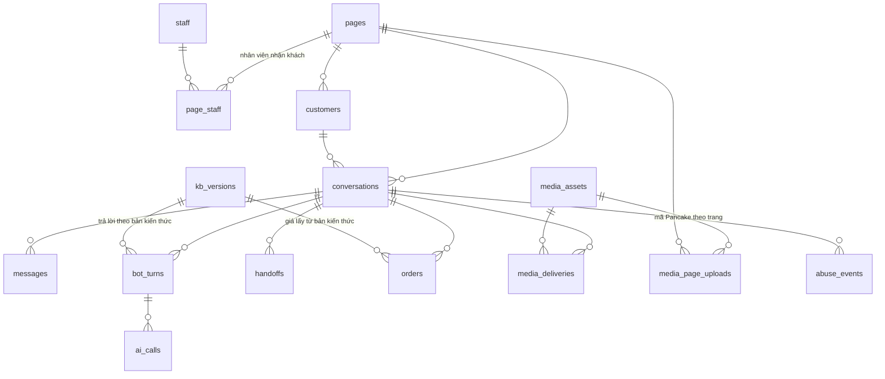

# Thiết kế Database & Google Sheet kho kiến thức – AI Agent Chat MagentX

Ngày: 20/11/2026 (bản 3) · Giai đoạn 3 · Trạng thái: **ĐÃ HOÀN THÀNH** (người dùng xác nhận ngày 20/11/2026). Bước tiếp theo: giai đoạn 4 – thiết kế giao diện và trải nghiệm, làm trong một chat mới của Project này.
Dựa trên: `claude/PRD-AI-Agent-Chat-MagentX-Pancake.md`, `claude/PRD-cap-nhat-20-11-2026.md`, `claude/Kien-truc-giai-doan-2-AI-Agent-Chat-MagentX.md`.
Chưa tạo database, chưa viết code. File SQL viết ở giai đoạn 5 từ bản thiết kế này.

## Nhật ký quyết định (20/11/2026)

| # | Quyết định |
|---|---|
| 1 | Áp dụng toàn bộ sửa đổi sau rà soát: khóa xử lý theo hội thoại, ghi tin "chờ gửi" trước khi gửi, nhận diện tin của bot, đồng bộ Sheet không xóa, bảng `system_state`, mỗi thông tin một nơi gốc, che SĐT chỉ tin khách, kiểm tra Sheet theo mức quan trọng, chống bấm trùng "Tiền đã về", định nghĩa "Bot chốt" |
| 2 | AI không tự viết số tiền: chỉ viết chỗ trống (vd `{gia:edit}`), code điền số từ Sheet |
| 3 | Nhật ký tin nhắn giữ 90 ngày |
| 4 | Giữ tab Chính sách riêng (12 tab) |
| 5 | STK trong Sheet bị đổi → bot giữ STK đã duyệt, chuyển người ở bước gửi CK, chờ quản trị bấm xác nhận trên Telegram |
| 6 | Không tự hủy đơn: gửi STK xong gắn tag **"Chờ chuyển khoản"**, đơn giữ trạng thái đó |
| 7 | Nhân viên và cài đặt chung để trong Google Sheet |
| 8 | **Database PostgreSQL chạy trên MacBook** cả lúc thử lẫn thời gian đầu chạy khách thật; chỉ chuyển lên Railway + Supabase Pro (Singapore) khi đạt mốc chất lượng (mục 10). Thay quyết định số 1 của giai đoạn 2 |
| 9 | Sao lưu mã hóa mỗi 2 giờ ra Google Drive |
| 10 | Khôi phục sau khi bot ngừng: dưới 30 phút trả lời bình thường; 30 phút–23 giờ trả lời kèm câu xin lỗi trả lời muộn (câu mẫu soạn sau); quá 23 giờ chuyển sale |
| 11 | Bot ngừng trong giờ 8h–22h → báo nhóm sale và/hoặc người có "Nhận cảnh báo bot ngừng = Có" (vd manager) |
| 12 | Không mua bộ lưu điện cho modem; mất điện/mạng thì bot ngừng và tự khôi phục |

---

## 0. Nguyên tắc chung

| # | Nguyên tắc | Lý do |
|---|---|---|
| 1 | **Giai đoạn Mac:** PostgreSQL cài trên MacBook, chỉ nhận kết nối từ chính Mac (localhost), mật khẩu riêng. **Giai đoạn máy chủ:** Supabase Pro, khu vực Singapore | 0 đồng lúc đầu; thiết kế chỉ dùng PostgreSQL chuẩn nên chuyển sang Supabase chỉ đổi địa chỉ kết nối |
| 2 | Không dùng tính năng riêng của Supabase trong code (Data API, Auth, Realtime) | Chạy giống nhau trên Mac và Supabase |
| 3 | Mọi bảng trong schema riêng `app`; ứng dụng dùng tài khoản database riêng `bot_app`. Trên Supabase: không mở schema `app` qua Data API, bật RLS mọi bảng, kết nối qua session pooler (cổng 5432) | Quyền tối thiểu; pg-boss không chạy qua transaction pooler |
| 4 | pg-boss tự tạo schema `pgboss`; giữ việc đã xong 1 ngày, xóa sau 7 ngày | Không phình to |
| 5 | Giờ lưu UTC; "một ngày" tính theo giờ Việt Nam | |
| 6 | Tiền là số nguyên VND; chi phí AI lưu USD (6 số lẻ) + VND | |
| 7 | Trạng thái lưu dạng chữ + ràng buộc danh sách giá trị | Dễ thêm trạng thái |
| 8 | SĐT chỉ ở `customers.phone` và `orders.phone`. Tin của khách được che SĐT trước khi lưu; tin bot không che | Không ghi SĐT vào log, không gửi SĐT cho AI |
| 9 | Mỗi thông tin một nơi gốc: tag → Pancake; kiến thức + cài đặt → Google Sheet; thanh toán → `orders`; công tắc khẩn cấp, STK đã duyệt → `system_state` | |
| 10 | Đồng bộ Sheet không bao giờ xóa dòng, chỉ `active = false`; khóa ngoại cấm xóa (RESTRICT) | Không mất lịch sử |
| 11 | Token, khóa bí mật, mật khẩu database, mật khẩu mã hóa bản sao lưu chỉ ở .env (Mac) / biến môi trường (Railway) và trình quản lý mật khẩu | |
| 12 | AI không tự viết số tiền và STK | Giá và STK luôn đúng |

---

## 1. Sơ đồ quan hệ

17 bảng, 5 nhóm:

- **A. Cấu hình:** `pages`, `staff`, `page_staff`, `kb_versions`, `system_state`
- **B. Khách & hội thoại:** `customers`, `conversations`, `messages`, `bot_turns`, `handoffs`
- **C. Bán hàng:** `orders`
- **D. Thư viện media:** `media_assets`, `media_page_uploads`, `media_deliveries`
- **E. Vận hành:** `ai_calls`, `abuse_events`, `alerts`

Bộ đếm (30 lượt AI/khách/ngày, 20 tin/phút, chi phí hôm nay, tỷ lệ chuyển người) tính trực tiếp từ nhật ký.

---

## 2. Chi tiết từng bảng

Ký hiệu: **PK** khóa chính · **FK** khóa ngoại (cấm xóa) · **UQ** không được trùng.

### A1. `pages` – Trang/kênh (từ tab Cài đặt trang)
| Cột | Kiểu | Ghi chú |
|---|---|---|
| id | uuid PK | |
| page_key | text UQ | vd `fb-magentx`, `ig-magentx`, `fb-test` |
| pancake_page_id | text UQ | |
| platform | text | facebook / instagram / tiktok / zalo_oa / other |
| name | text | |
| mode | text | off / test / on |
| is_test_page | bool | |
| course_codes | text[] | |
| address_style | text | minh_ban / em_anhchi |
| staff_hours_start, staff_hours_end | time | |
| rr_last_staff_id | uuid FK staff | |
| active | bool | |
| created_at, updated_at | timestamptz | |

### A2. `staff` – Nhân viên (từ tab Nhân viên; không xóa, chỉ `active = false`)
| Cột | Kiểu | Ghi chú |
|---|---|---|
| id | uuid PK | |
| name | text | |
| pancake_user_id | text UQ, có thể trống | |
| telegram_user_id | bigint UQ, có thể trống | |
| is_admin | bool | Cảnh báo hệ thống, `/tatbot`, duyệt STK mới |
| can_confirm_payment | bool | |
| receives_downtime_alerts | bool | Nhận tin riêng khi bot ngừng trong giờ trực (vd manager) |
| active | bool | |

### A3. `page_staff`
| Cột | Kiểu | Ghi chú |
|---|---|---|
| page_id, staff_id | FK | PK (page_id, staff_id) |
| receives_handoffs | bool | |

### A4. `kb_versions` – Bản chụp kho kiến thức
| Cột | Kiểu | Ghi chú |
|---|---|---|
| id | bigserial PK | |
| synced_at | timestamptz | |
| content_hash | text | |
| content | jsonb | |
| status | text | valid / partial / invalid |
| errors | jsonb | |
| is_active | bool | Chỉ một dòng true |
| bank_fingerprint | text | |

Giữ 30 bản gần nhất + bản được đơn tham chiếu.

### A5. `system_state` – Chỉ bot/Telegram được đổi (Sheet không ghi vào)
| Cột | Kiểu | Ghi chú |
|---|---|---|
| key | text PK | |
| value | jsonb | |
| updated_by_staff_id | FK staff, có thể trống | |
| updated_at | timestamptz | |

| key | Ý nghĩa |
|---|---|
| `emergency_stop:<page_key>` / `emergency_stop:all` | Tắt khẩn cấp (lệnh `/tatbot`) |
| `approved_bank_fingerprint` | STK đã duyệt |
| `savings_mode` | Chế độ tiết kiệm |
| `last_kb_sync_ok_at` | Lần đồng bộ Sheet thành công gần nhất |
| `last_processed_at:<page_key>` | Mốc tin cuối đã xử lý của từng trang → dùng để nhặt tin bị sót khi khôi phục |
| `last_heartbeat_at` | Bot tự ghi mỗi phút → biết bot đã ngừng từ lúc nào |
| `last_backup_ok_at` | Lần sao lưu thành công gần nhất |

### B1. `customers` – Hồ sơ khách
| Cột | Kiểu | Ghi chú |
|---|---|---|
| id | uuid PK | |
| page_id | FK | UQ (page_id, pancake_customer_id) |
| pancake_customer_id | text | |
| display_name | text | |
| **phone** | text, có thể trống | Dạng `0xxxxxxxxx` |
| phone_collected_at | timestamptz | |
| interested_courses | text[] | |
| experience_level | text | |
| goal, pain_points, objections | text | F11–F12 |
| profile_summary | text | Lớp 1 trí nhớ |
| first_seen_at, last_seen_at | timestamptz | |

### B2. `conversations` – Hội thoại
"Ai đang giữ hội thoại" không lưu riêng: mỗi lần xử lý tính lại từ tag đọc từ Pancake + `bot_paused_until` + `system_state`.

| Cột | Kiểu | Ghi chú |
|---|---|---|
| id | uuid PK | |
| page_id | FK | UQ (page_id, pancake_conversation_id) |
| customer_id | FK | |
| pancake_conversation_id | text | |
| stage | text | new / discovering / consulting / asking_contact / payment_sent |
| tags | text[] | Bản sao để tra cứu, không dùng làm căn cứ |
| tags_synced_at | timestamptz | |
| is_test | bool | |
| processing_since | timestamptz | |
| bot_paused_until | timestamptz | |
| last_customer_msg_at, last_staff_msg_at, last_bot_msg_at | timestamptz | |
| images_read_count, misunderstood_count, abuse_count | int | |
| source_ad_id | text | |
| started_from_ad_auto_reply | bool | |
| memory_summary | text | Lớp 3 trí nhớ |
| memory_summary_upto | timestamptz | |
| assigned_staff_id | FK staff | |
| created_at, updated_at | timestamptz | |

### B3. `messages` – Nhật ký tin nhắn (90 ngày) + sổ chờ gửi
| Cột | Kiểu | Ghi chú |
|---|---|---|
| id | bigserial PK | |
| conversation_id | FK | UQ (conversation_id, pancake_message_id) |
| pancake_message_id | text, có thể trống | |
| client_ref | text UQ, có thể trống | Mã chống trùng tin bot |
| direction | text | in / out |
| sender_type | text | customer / bot / staff / meta_auto / unknown |
| status | text | received / pending / sent / failed |
| staff_id | FK, có thể trống | |
| content_masked | text | Tin khách che SĐT; ≤2.000 ký tự |
| content_hash | text | |
| attachment_type | text | none / image / sticker / video / audio / file / link |
| sent_at, created_at | timestamptz | |

Chỉ mục: (conversation_id, sent_at giảm dần); (status, created_at); (sent_at).

### B4. `bot_turns` – Mỗi lượt bot xử lý
| Cột | Kiểu | Ghi chú |
|---|---|---|
| id | bigserial PK | |
| conversation_id, page_id | FK | |
| last_customer_msg_at, replied_at | timestamptz | |
| latency_ms | int | |
| is_recovery | bool | Lượt xử lý tin bị sót sau khi bot ngừng → không tính vào chỉ số 5 giây |
| route | text | template / ai_haiku / ai_sonnet / handoff / blocked / ignored / superseded |
| block_reason | text | |
| validation | text | passed / failed / not_applicable |
| kb_version_id | FK | |
| media_sent_count | int | |
| created_at | timestamptz | |

### B5. `handoffs` – Lần chuyển nhân viên
| Cột | Kiểu | Ghi chú |
|---|---|---|
| id | bigserial PK | |
| conversation_id, page_id | FK | |
| reason | text | |
| detail | text | |
| bot_turn_id | FK | |
| out_of_hours | bool | |
| assigned_staff_id | FK | |
| created_at, resolved_at | timestamptz | |
| resolved_by | text | tag_removed / return_to_bot / auto_timeout |

Mã lý do: customer_request · kb_missing · bill_received · discount_installment_invoice · complaint_refund · old_student · misunderstood_3x · asked_if_bot · link_video_voice · image_limit · ai_quota · validation_failed · ai_error · savings_mode · bank_unapproved · late_over_23h (tin chờ quá 23 giờ do bot ngừng).

### C1. `orders` – Phiếu đơn
| Cột | Kiểu | Ghi chú |
|---|---|---|
| id | uuid PK | |
| order_code | text UQ | `MGX` + 6 ký tự (bỏ 0/O/1/I) |
| page_id, conversation_id, customer_id | FK | |
| customer_name | text | |
| **phone** | text | |
| course_codes | text[] | |
| offer_code | text | |
| list_price_vnd, amount_vnd | bigint | Code tính từ kho kiến thức lúc gửi STK |
| kb_version_id | FK | |
| status | text | awaiting_transfer (tag **Chờ chuyển khoản**) / awaiting_confirmation (tag Chờ xác nhận CK) / paid (tag Đã mua) / cancelled |
| closed_by | text | bot / staff |
| payment_info_sent_at, bill_received_at, confirmed_at | timestamptz | |
| confirmed_by_staff_id | FK | |
| confirm_channel | text | telegram / pancake_tag |
| telegram_message_id | bigint | |
| cancelled_at, cancel_reason | | |
| email | text, trống | |
| exported_to, exported_at | trống | |
| created_at, updated_at | timestamptz | |

Quy tắc:
- **Không tự hủy đơn.** Đơn ở trạng thái Chờ chuyển khoản cho đến khi khách gửi bill hoặc nhân viên hủy.
- Mỗi hội thoại chỉ một đơn đang dở. Khách đổi khóa khi đơn đang chờ → đơn cũ chuyển Hủy (lý do: đổi khóa), tạo đơn mới với mã mới và gửi thông tin CK cho đơn mới. Không bao giờ gửi STK hai lần cho cùng một đơn.
- Khách chuyển tiền sau khi ưu đãi hết hạn: đơn giữ số tiền lúc gửi STK; sale đối chiếu số tiền khi bấm "Tiền đã về".
- Chống bấm trùng: chỉ cập nhật khi đơn còn Chờ xác nhận; người bấm sau nhận "Đã được [tên] xác nhận lúc [giờ]".
- "Bot chốt": đơn đã thanh toán, từ tin đầu của khách đến lúc gửi bill không có tin nhân viên và không có lần chuyển người nào (trừ chuyển vì bill).

### D1. `media_assets`
| Cột | Kiểu | Ghi chú |
|---|---|---|
| id | uuid PK | |
| file_name | text UQ | `khoa_loai_chude_so` |
| course_code, kind, topic | text | |
| description, send_when | text | AI chỉ đọc 2 cột này |
| mime, size_bytes, file_hash | | |
| status | text | ready / missing_file / missing_description / too_large / disabled |
| active | bool | |
| updated_at | timestamptz | |

### D2. `media_page_uploads`
| Cột | Kiểu | Ghi chú |
|---|---|---|
| asset_id, page_id | FK | PK |
| pancake_content_id | text | |
| uploaded_hash | text | |
| uploaded_at, last_send_ok_at | timestamptz | |
| fail_count | int | |

### D3. `media_deliveries`
| Cột | Kiểu | Ghi chú |
|---|---|---|
| conversation_id, asset_id | FK | PK |
| bot_turn_id | FK | |
| sent_at | timestamptz | |

### E1. `ai_calls` (không lưu nội dung)
| Cột | Kiểu | Ghi chú |
|---|---|---|
| id | bigserial PK | |
| page_id, conversation_id, bot_turn_id | FK, có thể trống | |
| purpose | text | reply / summary / image_read |
| model | text | |
| input_tokens, cache_read_tokens, cache_write_tokens, output_tokens | int | |
| cost_usd | numeric(12,6) | |
| cost_vnd | int | |
| latency_ms | int | |
| status | text | ok / error / timeout |
| created_at | timestamptz | |

### E2. `abuse_events` (90 ngày)
| Cột | Kiểu | Ghi chú |
|---|---|---|
| id | bigserial PK | |
| conversation_id, page_id | FK | |
| kind | text | injection / ask_system_prompt / code_request / off_topic / flood |
| matched_rule | text | |
| snippet_masked | text | ≤200 ký tự |
| created_at | timestamptz | |

### E3. `alerts`
| Cột | Kiểu | Ghi chú |
|---|---|---|
| id | bigserial PK | |
| kind | text | spend_80 / spend_over / handoff_rate_30 / bot_silent / bot_recovered / kb_invalid / kb_partial / bank_changed / media_issue / error_burst / kb_sync_stale / backup_failed / drive_almost_full / weekly_quality |
| page_id | FK, có thể trống | |
| dedupe_key | text | UQ (kind, dedupe_key) |
| payload | jsonb | Không SĐT |
| sent_at | timestamptz | |

---

## 3. Xử lý đồng thời và chống gửi trùng

**3.1 Mỗi hội thoại một việc xử lý tại một thời điểm:** pg-boss "mỗi hội thoại một việc" + khóa theo mã hội thoại trong database. Đặt `processing_since`; trước khi gửi, có tin khách mới → bỏ bản đang soạn (superseded), soạn lại.

**3.2 Ghi trước, gửi sau:**
1. Ghi tin vào `messages` (pending, `client_ref`, `content_hash`).
2. Gọi Pancake gửi.
3. Thành công → sent + `pancake_message_id`; lỗi → failed.
4. Thử lại mà còn pending → đọc lại hội thoại trên Pancake trước khi gửi lại.
5. STK/QR chỉ gửi khi đơn chưa có `payment_info_sent_at`.

**3.3 Nhận ra tin của bot:** (1) trùng mã tin bot đã lưu; (2) trùng `content_hash` tin bot trong 60 giây; (3) khớp câu trả lời tự động quảng cáo → meta_auto; (4) còn lại → nhân viên → bot dừng 24 giờ. Bắt buộc thử ở giai đoạn 5.

---

## 4. Tiền và STK: AI chỉ viết chỗ trống

| Chỗ trống | Code điền |
|---|---|
| `{gia:ma_khoa}` | Giá hiện hành (ưu đãi nếu đang hiệu lực, không thì giá gốc) |
| `{gia_goc:ma_khoa}` | Giá gốc |
| `{tiet_kiem:ma_khoa}` | Giá gốc − giá ưu đãi |
| `{phan_tram_giam:ma_khoa}` | % giảm |
| `{han_uu_dai:ma_khoa}` | Câu về hạn ưu đãi |
| `{gia_combo:ma_combo}` | Giá combo |

STK, chủ tài khoản, QR, nội dung CK do code tự gửi bằng câu mẫu "gui-stk". Bước kiểm tra: chỗ trống sai tên / khóa không tồn tại / ưu đãi hết hạn, hoặc AI tự viết con số kèm đơn vị tiền (k, nghìn, ngàn, tr, triệu, đ, đồng, vnd, %) → không qua → chuyển nhân viên im lặng (validation_failed). Tiền hiển thị thống nhất dạng `1.990.000đ`.

---

## 5. Khôi phục sau khi bot ngừng (Mac tắt, mất điện, mất mạng, cập nhật)

**Trong lúc ngừng:** Pancake vẫn chạy, khách vẫn nhắn, nhân viên trả lời tay được. UptimeRobot (bên ngoài) phát hiện bot không phản hồi quá 5 phút → báo Telegram cho quản trị; nếu đang trong giờ trực (8h–22h) báo thêm nhóm sale và người có "Nhận cảnh báo bot ngừng = Có": "Bot đang ngừng, sale trực inbox giúp".

**Khi có lại:**
1. Ứng dụng, PostgreSQL, đường hầm tự khởi động.
2. Bot so `last_heartbeat_at` để biết đã ngừng bao lâu, rồi quét lại các hội thoại có tin mới từ `last_processed_at` của từng trang → không sót tin.
3. Với mỗi hội thoại bị sót:

| Tình huống | Bot làm gì |
|---|---|
| Nhân viên đã trả lời tay | Không chen vào (dừng 24 giờ) |
| Có bill | Xử lý bình thường |
| Tin chờ dưới 30 phút | Trả lời bình thường, gộp mọi tin thành một lượt |
| Tin chờ 30 phút – 23 giờ | Trả lời, mở đầu bằng câu mẫu `xin-loi-tra-loi-muon` (người dùng soạn sau) |
| Tin chờ quá 23 giờ | Không gửi; tag Cần người (late_over_23h) + danh sách lên Telegram cho sale |

4. Xử lý tối đa 5 hội thoại cùng lúc, khách chờ lâu nhất trước; các lượt này đánh dấu `is_recovery` (không tính vào chỉ số 5 giây).
5. Không gửi trùng (mục 3.2). Hàng chờ, bộ đếm, hẹn giờ nằm trong database nên vẫn đúng. Lần bấm "Tiền đã về" trong lúc ngừng được Telegram giữ tối đa 24 giờ. Kiến thức dùng bản đã lưu rồi đồng bộ lại.
6. Gửi báo cáo khôi phục lên Telegram: ngừng từ lúc nào, bao lâu, đã trả lời bao nhiêu hội thoại, bao nhiêu chuyển sale.

**Lưu ý:** FileVault bật → Mac khởi động lại bất ngờ (treo, hết pin hẳn) sẽ dừng ở màn hình nhập mật khẩu; ứng dụng chỉ chạy lại khi có người gõ mật khẩu trên Mac. Cập nhật macOS có chủ đích dùng cách khởi động lại một lần không cần mật khẩu (hướng dẫn ở giai đoạn 9). Mất điện: MacBook chạy bằng pin, nhưng modem tắt → bot mất mạng (đã chấp nhận, không mua bộ lưu điện).

---

## 6. Mỗi bước trong luồng đọc/ghi bảng nào

| Bước | Đọc | Ghi |
|---|---|---|
| 1. Webhook / vòng quét 30 giây | pages | messages, system_state (last_processed_at) |
| 2–3. Chống trùng, gộp tin | messages | hàng chờ pgboss |
| 4. Cổng chặn | system_state, pages, tag từ Pancake, conversations, bot_turns, messages, ai_calls | bot_turns (blocked) |
| 5. Bộ lọc | kb_versions, conversations | handoffs, abuse_events, conversations, orders |
| 6. Gọi AI | kb_versions, customers, messages, conversations, media_assets | ai_calls |
| 7. Kiểm tra + điền chỗ trống | kb_versions, system_state, media_deliveries | handoffs (nếu không qua) |
| 8. Thực thi | media_page_uploads, page_staff | messages, media_deliveries, orders, conversations, customers |
| 9. Ghi sổ | | bot_turns |
| Telegram "Tiền đã về" | staff | orders, tag Đã mua (+ Bot chốt) |
| Telegram `/tatbot`, duyệt STK | staff (is_admin) | system_state |
| Đồng bộ Sheet 5 phút | Google Sheet | kb_versions, pages, staff, page_staff, media_assets, alerts |
| Nhịp tim mỗi phút | | system_state (last_heartbeat_at) |
| Sao lưu mỗi 2 giờ | toàn bộ database | file mã hóa trên Google Drive, system_state (last_backup_ok_at), alerts |

---

## 7. Phân quyền truy cập database

| Tài khoản | Dùng khi | Quyền |
|---|---|---|
| `postgres` (chủ) | Chỉ khi chạy migration | Toàn quyền, không đặt trong ứng dụng |
| `bot_app` | Ứng dụng bot | Đọc/thêm/sửa bảng trong `app`; xóa chỉ ở bảng nhật ký để dọn theo hạn |
| `backup_reader` | Script sao lưu | Chỉ đọc |
| `report_reader` | P2 | Chỉ đọc view báo cáo không có SĐT |
| anon / authenticated (Supabase) | Không dùng | Không thấy schema `app` |

---

## 8. Thời hạn lưu và dung lượng

| Dữ liệu | Giữ | Cách xóa |
|---|---|---|
| messages | 90 ngày (Pancake vẫn giữ lịch sử chat) | Hằng đêm |
| abuse_events, alerts | 90 ngày | Hằng đêm |
| bot_turns, ai_calls | 13 tháng | Hằng tháng |
| kb_versions | 30 bản + bản được đơn tham chiếu | Sau đồng bộ |
| pgboss | Xong giữ 1 ngày, xóa sau 7 ngày | Tự động |
| customers, conversations, orders | Lâu dài (chờ luật sư) | Khách yêu cầu xóa → script riêng |

Dung lượng cao điểm với 90 ngày tin nhắn: khoảng 0,3–0,45 GB. Trên Mac không có giới hạn gói; khi chuyển lên Supabase Pro (8 GB) dư thoải mái.

---

## 9. Sao lưu, bảo vệ Mac và migration

### 9.1 Điều kiện bắt buộc trước khi có khách thật trên Mac
1. FileVault bật; tài khoản Mac có mật khẩu mạnh; tự khóa màn hình sau vài phút.
2. PostgreSQL chỉ nhận kết nối từ chính Mac (localhost), mật khẩu riêng.
3. Sao lưu tự động (mục 9.2) đã chạy ổn ít nhất 3 ngày.
4. Đã thử khôi phục thành công một lần.

### 9.2 Sao lưu (giai đoạn Mac)
- **Mỗi 2 giờ:** xuất toàn bộ database (pg_dump), nén, mã hóa bằng mật khẩu riêng (cất trong trình quản lý mật khẩu), chép lên Google Drive (tài khoản có 2FA).
- Giữ **24 bản gần nhất** (2 ngày) + **bản 3h sáng của 14 ngày**. Mac hỏng → mất tối đa 2 giờ dữ liệu; phần đó khôi phục bằng tay từ Pancake (tag, ghi chú có SĐT + mã đơn) và tin đơn trên Telegram.
- Không tốn tiền AI. Dung lượng Drive dự kiến vài GB, trong 15 GB miễn phí.
- Báo Telegram khi: sao lưu lỗi, quá 4 giờ chưa có bản thành công, Drive gần đầy.
- Thử khôi phục 2 tuần một lần vào database tạm trên Mac.

### 9.3 Migration
- Mỗi thay đổi cấu trúc là một file SQL đánh số trong `db/migrations/`, lưu GitHub; file đã chạy không sửa.
- Trên Mac có 2 database: `magentx_test` và `magentx_live` (mật khẩu khác nhau). Migration chạy trên test trước.
- Migration đầu (giai đoạn 5): 0001 schema `app` + role + 17 bảng · 0002 chỉ mục, ràng buộc · 0003 phân quyền (+ RLS khi lên Supabase).

---

## 10. Lộ trình nơi chạy và mốc chuyển lên máy chủ

| Giai đoạn | Bot | Database | Chi phí database |
|---|---|---|---|
| Thử trên fanpage thử | MacBook | MacBook (`magentx_test`) | 0 đ |
| Khách thật thời gian đầu (dự kiến 10–30 ngày) | MacBook | MacBook (`magentx_live`) + sao lưu 2 giờ | 0 đ |
| Đạt mốc → chuyển | Railway | Supabase Pro, Singapore | ~25 USD/tháng (~660.000 đ) |

**Mốc chuyển (14 ngày liên tiếp đạt đủ; bot gửi bảng số hằng tuần qua Telegram; người dùng có thể chỉnh mốc):**
- 0 lần sai giá, ưu đãi, STK
- Tỷ lệ chuyển nhân viên < 30%; bot tự xử lý ≥ 70%
- Câu trả lời không qua kiểm tra < 2%
- ≥ 95% tin trả lời trong mục tiêu thời gian
- Không lần nào bot ngừng > 15 phút mà không ai biết
- Người dùng + 1 sale đọc 30 hội thoại thật, đồng ý giọng văn ổn

**Chuyển sớm hơn nếu:** Mac trục trặc (ổ đầy, treo, sao lưu lỗi nhiều lần), cần mang Mac đi hoặc dùng việc nặng, hoặc đã quá 60 ngày chạy khách thật.

**Cách chuyển:** tập dượt 2–3 ngày trên Supabase với fanpage thử → chuyển ứng dụng và database cùng một đêm (pg_dump → khôi phục vào Supabase → đổi địa chỉ kết nối → kiểm tra) → giữ database trên Mac thêm 7 ngày làm dự phòng rồi xóa an toàn.

**Pháp lý:** trước khi bật khách thật, hỏi luật sư một lần về dữ liệu khách ra nước ngoài (Claude, Pancake; sau này Supabase Singapore) và thời hạn lưu SĐT/đơn. Giai đoạn database trên Mac: dữ liệu database nằm tại Việt Nam.

---

## 11. Google Sheet kho kiến thức

### 11.1 Quy tắc chung
- Một file "MagentX – Kho kiến thức Bot". Chỉ người dùng sửa; tài khoản bot chỉ Xem. Google bật 2FA.
- Múi giờ file GMT+7 (bot kiểm tra mỗi lần đồng bộ).
- Dòng 1 là tên cột — không đổi tên, không chèn cột giữa (dòng được khóa). Bot chuẩn hóa chữ có dấu khi so tên cột.
- Bot đọc giá trị gốc của ô (số, không phải chữ đã định dạng).
- Cột bắt đầu bằng "Nội bộ" không đưa cho AI. Dòng có Dùng = Không bị bỏ qua. Xóa dòng → bot tắt mục đó, không xóa lịch sử.
- Đọc 5 phút/lần, kiểm tra theo mức quan trọng:

| Mức | Tab | Khi có lỗi |
|---|---|---|
| Quan trọng | Khóa học, Ưu đãi, Chuyển khoản, Cài đặt trang, Nhân viên, Cài đặt chung | Giữ toàn bộ bản cũ + báo Telegram |
| Phụ | FAQ, Chính sách, Câu mẫu, Thư viện media, Từ khóa | Bỏ dòng lỗi + báo Telegram |

- Giá không đưa dạng số cho AI; AI chỉ biết tên chỗ trống (mục 4).

### 11.2 Danh sách tab (12)

| # | Tab | Mức | Đưa cho AI? |
|---|---|---|---|
| 0 | Đọc trước | — | Không |
| 1 | Khóa học | Quan trọng | Có, giá thay bằng chỗ trống |
| 2 | Ưu đãi | Quan trọng | Có (đang hiệu lực), giá thay bằng chỗ trống |
| 3 | FAQ | Phụ | Có |
| 4 | Chính sách | Phụ | Có |
| 5 | Chuyển khoản | Quan trọng | Không — code tự gửi |
| 6 | Câu mẫu | Phụ | Phần "Trả lời tự động QC" có |
| 7 | Thư viện media | Phụ | Chỉ cột mô tả |
| 8 | Từ khóa | Phụ | Không |
| 9 | Cài đặt trang | Quan trọng | Không |
| 10 | Nhân viên | Quan trọng | Không |
| 11 | Cài đặt chung | Quan trọng | Không |

### 11.3 Cột từng tab
(Số liệu ví dụ chỉ để minh họa.)

**Tab 1 – Khóa học**

| Cột | Ví dụ | Bắt buộc | Kiểm tra |
|---|---|---|---|
| Mã khóa | edit | ✔ | Không trùng, chữ thường không dấu |
| Loại | Khóa lẻ / Combo | ✔ | |
| Gồm khóa | edit, video-ai | Combo bắt buộc | Mã tồn tại |
| Tên khóa | Khóa Edit video | ✔ | |
| Trạng thái | Đang bán / Sắp ra mắt / Ẩn | ✔ | |
| Giá gốc (VND) | 1990000 | ✔ | Số > 0 |
| Hình thức | Online / Offline / Cả hai | ✔ | |
| Thời lượng, Số buổi, Lịch học | | | |
| Nội dung, Quyền lợi | | ✔ | Không chứa số tiền |
| Ai nên học / Ai không nên học | | ✔ / | |
| Kết quả sau khóa, Hỗ trợ sau khóa | | | |
| Nội bộ – ghi chú | | | Không đưa cho AI |
| Dùng | Có / Không | ✔ | |

**Tab 2 – Ưu đãi**

| Cột | Ví dụ | Kiểm tra |
|---|---|---|
| Mã ưu đãi | BF2026-EDIT | Không trùng |
| Áp dụng cho mã khóa | edit | Mã tồn tại |
| Tên ưu đãi | Black Friday | |
| Giá sau ưu đãi (VND) | 1490000 | > 0 và < giá gốc |
| Bắt đầu / Kết thúc | 20/11/2026 00:00 · 30/11/2026 23:59 | Kết thúc sau bắt đầu |
| Điều kiện | | Không chứa số tiền |
| Câu bot được nói về hạn | "Ưu đãi đến hết 30/11" | |
| Dùng | Có / Không | |

Mỗi khóa tối đa một ưu đãi hiệu lực cùng lúc; hết hạn tự về giá gốc.

**Tab 3 – FAQ:** Mã câu · Chủ đề · Áp dụng cho mã khóa · Câu hỏi · Cách hỏi khác (dấu ;) · Câu trả lời chuẩn (giá dùng chỗ trống) · Dùng nguyên văn (Có = câu mẫu không tốn AI / Không = AI diễn đạt lại) · Dùng.

**Tab 4 – Chính sách:** Mã · Tên (Hoàn phí / Bảo lưu / Hỗ trợ sau khóa / Combo / Hóa đơn) · Áp dụng cho mã khóa · Nội dung · Bot xử lý (Tự trả lời / Chuyển người) · Dùng.

**Tab 5 – Chuyển khoản**

| Cột | Kiểm tra |
|---|---|
| Áp dụng cho trang | Mỗi trang đúng 1 dòng đang dùng |
| Ngân hàng, Mã ngân hàng (BIN) | |
| Số tài khoản | Chỉ chữ số |
| Chủ tài khoản | In hoa không dấu |
| Mẫu nội dung CK | Phải có `{ma_don}` |
| Dùng | |

Thông tin chuyển khoản khác `approved_bank_fingerprint` → bot không gửi STK (chuyển người, bank_unapproved), báo Telegram; quản trị bấm "Xác nhận STK mới" mới áp dụng.

**Tab 6 – Câu mẫu:** Mã câu · Loại (Bot dùng / Trả lời tự động QC) · Tình huống · Nội dung (mình – bạn) · Nội dung (em – anh/chị) · Tên quảng cáo/mã QC · Câu hỏi mẫu trong QC · Dùng. Biến: `{ten_khach}` `{ten_khoa}` `{ma_don}` `{so_tien}` + chỗ trống giá. Câu mẫu bắt buộc phải có trước khi chạy: chao-hoi, tu-choi-lac-de, xac-nhan-bill, gui-stk, **xin-loi-tra-loi-muon** (người dùng soạn sau).

**Tab 7 – Thư viện media:** Tên file · Mã khóa · Loại (feedback/showcase/demo) · Nội dung file (bắt buộc) · Gửi khi nào · Dùng.

**Tab 8 – Từ khóa:** Từ khóa/cụm từ · Nhóm (Cần người / Người hay bot / Lừa bot / Giảm giá-trả góp-hóa đơn / Khiếu nại) · Hành động (Chuyển người im lặng / Câu từ chối mẫu) · Mã lý do · Dùng.

**Tab 9 – Cài đặt trang:** Mã trang · Mã trang Pancake · Tên trang · Nền tảng · Trang thử nghiệm · Chế độ (Tắt/Thử nghiệm/Bật) · Khóa học tư vấn · Xưng hô · Giờ trực bắt đầu/kết thúc · Nhân viên nhận khách. (Tắt khẩn cấp bằng `/tatbot` trên Telegram.)

**Tab 10 – Nhân viên:** Tên · Mã nhân viên Pancake · Telegram ID · Quản trị · Được bấm "Tiền đã về" · **Nhận cảnh báo bot ngừng** (Có/Không) · Đang làm.

**Tab 11 – Cài đặt chung**

| Cài đặt | Mặc định | Giới hạn hợp lệ |
|---|---|---|
| Hạn mức AI tháng | 3.000.000 đ | 500.000–7.000.000 |
| Hạn mức AI ngày | 100.000 đ | 20.000–300.000 |
| Ngưỡng cảnh báo chi phí | 80% | 50–95% |
| Lượt AI mỗi khách mỗi ngày | 30 | 5–100 |
| Tin tối đa mỗi phút / khách | 20 | 5–60 |
| Chờ gộp tin / tối đa | 4 / 12 giây | 1–8 / 5–20 |
| Bot dừng sau khi nhân viên nhắn | 24 giờ | 1–72 |
| Ảnh tối đa / hội thoại | 3 | 0–10 |
| Cảnh báo tỷ lệ chuyển người | 30% | 10–80% |
| Tỷ lệ Sonnet tối đa | 5% | 0–20% |
| Tỷ giá USD | 26.500 | 20.000–35.000 |
| Link được phép gửi | magentx.ai (vd) | |
| Trả lời muộn: mốc xin lỗi | 30 phút | 5–120 |
| Trả lời muộn: mốc chuyển sale | 23 giờ | 1–23 |
| Hội thoại xử lý cùng lúc khi khôi phục | 5 | 1–10 |

Giá trị ngoài giới hạn → giữ giá trị cũ + báo Telegram.

---

## 12. Kết luận giai đoạn
Không còn câu hỏi mở. Người dùng duyệt bản 3 ngày 20/11/2026 → giai đoạn 3 ĐÃ HOÀN THÀNH. Giai đoạn 4 (thiết kế giao diện và trải nghiệm: Telegram, Google Sheet mẫu, phía Pancake/khách hàng) làm trong chat mới.
